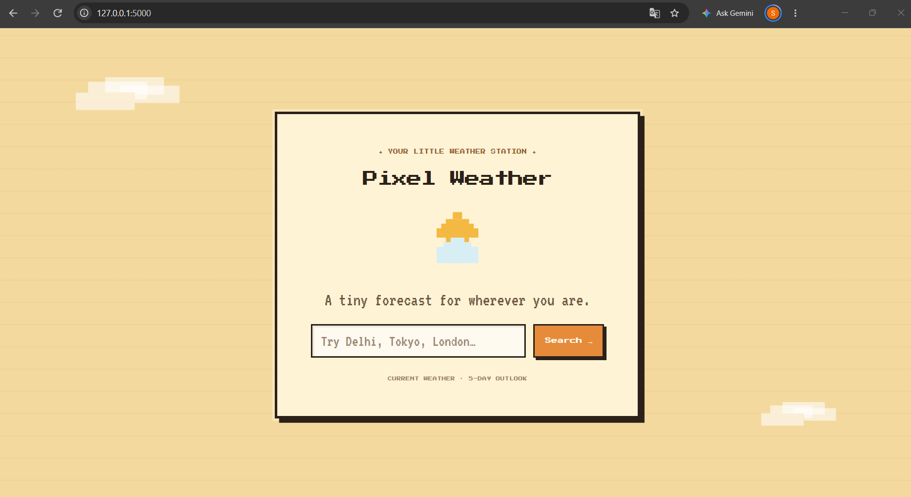
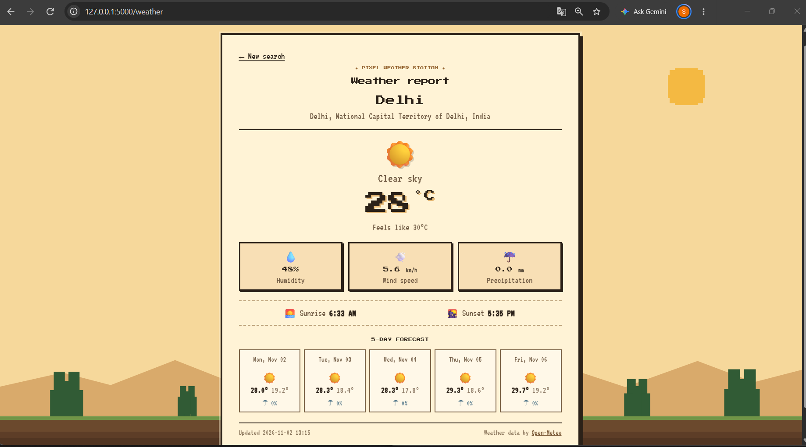
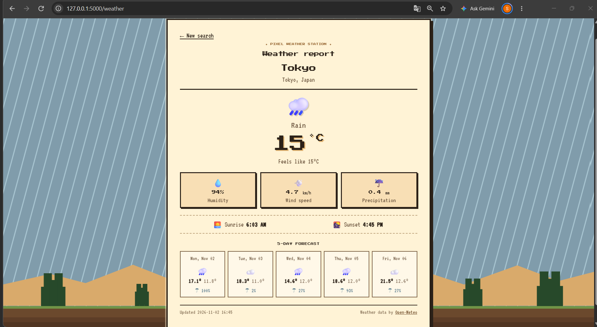

# Pixel Weather ☀️

A small weather station with a retro pixel-art landscape. Search for a city to see its current weather conditions, useful weather details, sunrise and sunset times, and a five-day forecast.

Built with **Python, Flask, HTML, CSS, and the free [Open-Meteo APIs](https://open-meteo.com/)**. No API key is required.

## Features

- Search for a city using Open-Meteo geocoding.
- Current temperature and feels-like temperature.
- Humidity, wind speed, and precipitation information.
- Sunrise and sunset in the searched location's local time.
- Five-day forecast with daily high/low temperatures and precipitation probability.
- Weather-aware pixel-art scenes with CSS effects for clear, cloudy, foggy, drizzly, rainy, snowy, and stormy conditions.
- Responsive layout for desktop and mobile.
- Graceful handling of empty searches, unknown cities, network failures, and API timeouts.

## Preview

### Home Page



### Weather Report – Delhi



### Weather Report – Tokyo



## Tech Stack

- **Backend:** Python, Flask, Requests
- **Frontend:** HTML, CSS
- **Weather Data:** Open-Meteo Geocoding API and Forecast API
- **Deployment:** Gunicorn

## Run Locally

### 1. Clone the repository

```bash
git clone https://github.com/sanchita-22/weather-app.git
cd weather-app
```

### 2. Create and activate a virtual environment

**Windows PowerShell:**

```powershell
python -m venv .venv
.venv\Scripts\Activate.ps1
```

If PowerShell blocks activation, use Command Prompt:

```bat
.venv\Scripts\activate.bat
```

**macOS / Linux:**

```bash
python3 -m venv .venv
source .venv/bin/activate
```

### 3. Install dependencies

```bash
python -m pip install -r requirements.txt
```

### 4. Start the application

```bash
python app.py
```

Open [http://127.0.0.1:5000](http://127.0.0.1:5000) in your browser.

## Run Tests

The test suite uses Python's built-in `unittest` framework and mocks API responses, so it does not require a live weather API connection.

```bash
python -m unittest discover -s tests -v
```

## Deployment

The repository includes a `Procfile` for platforms that support Gunicorn.

Production start command:

```bash
gunicorn app:app
```

The application reads the optional `PORT` environment variable when run directly. No API keys or weather-service credentials are required.

For public deployment, use an HTTPS-enabled web service and follow the platform's recommended Python runtime configuration.

## Project Structure

```text
weather-app/
├── app.py
├── requirements.txt
├── Procfile
├── README.md
├── .gitignore
├── tests/
│   └── test_app.py
├── templates/
│   ├── index.html
│   └── weather.html
├── static/
│   └── style.css
└── screenshots/
    ├── home.png
    ├── weather-preview.png
    └── tokyo-weather.png
```

## API Usage

- [Open-Meteo Geocoding API](https://open-meteo.com/en/docs/geocoding-api) resolves city names into geographic coordinates.
- [Open-Meteo Forecast API](https://open-meteo.com/en/docs) provides current weather conditions and daily forecast values.

Open-Meteo is used without an API key for this project. Weather data is provided by the service and may be updated according to its schedule. It should not be interpreted as official emergency information.

## Notes

- The first geocoding match is selected when a city name has multiple matches.
- The five-day forecast displays daily high/low temperatures and maximum precipitation probability.
- Daily forecast condition icons are generic because the application currently requests daily temperature and precipitation fields, not daily weather codes.
- Google Fonts are loaded externally, with system monospace fallbacks available if the font service cannot be reached.

## License

This project is intended for learning and portfolio use. Review the [Open-Meteo terms](https://open-meteo.com/en/terms) before using the service commercially.